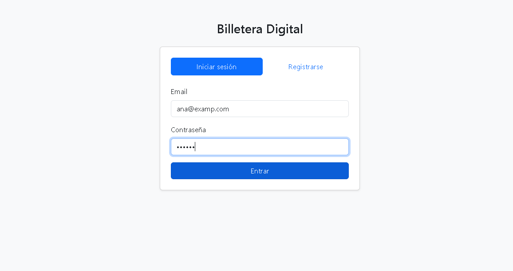
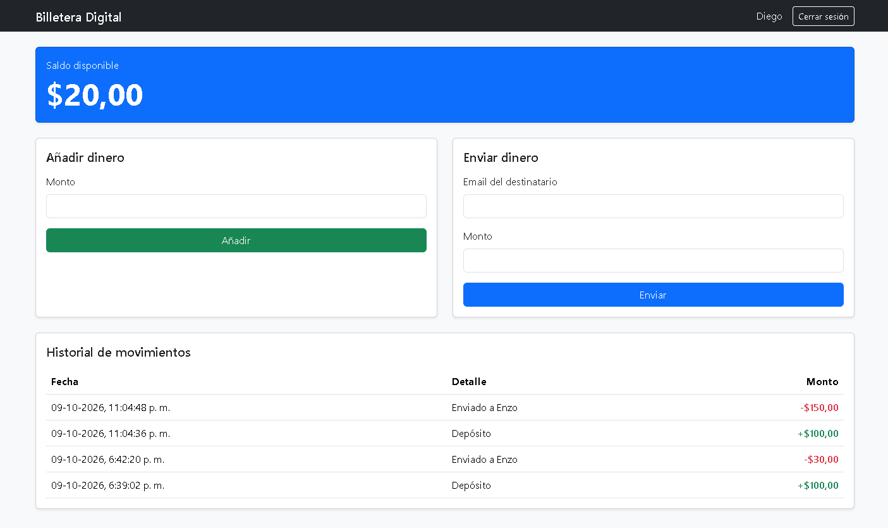
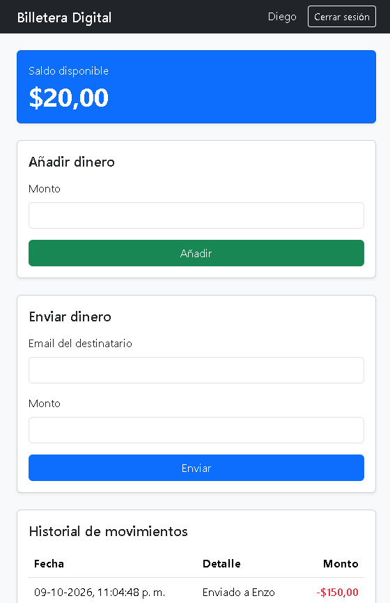

# Billetera Digital

Aplicación web full-stack para gestionar dinero entre usuarios: permite
registrarse, añadir dinero, enviar dinero a otros usuarios y consultar
el historial de movimientos.

**Demo:** **Demo:** https://billetera-digital-eypa.onrender.com

> El servidor gratuito se duerme tras un rato sin uso, así que la primera
> carga puede tardar hasta un minuto. Es un proyecto educativo: no uses
> datos ni dinero reales.
**Usuario de prueba:** demo@correo.com / contraseña: demo1234

## Tecnologías
Node.js, Express, PostgreSQL, JWT, bcrypt, HTML, CSS, Bootstrap, JavaScript

## Funcionalidades
- Registro e inicio de sesión con contraseñas cifradas (bcrypt) y JWT
- Rutas protegidas con middleware de autenticación
- Depósitos y transferencias entre usuarios con transacciones SQL
  (si algo falla, no se pierde dinero a medias)
- Validaciones de monto, saldo insuficiente y destinatario
- Historial de movimientos y saldo en tiempo real
- Interfaz responsive con Bootstrap

## Cómo ejecutarlo
1. Clona el repositorio e instala dependencias: `npm install`
2. Crea una base de datos PostgreSQL llamada `billetera`
3. Ejecuta `sql/schema.sql` para crear las tablas
4. Copia `.env.example` a `.env` y completa tus datos
5. Inicia el servidor: `npm run dev`
6. Abre http://localhost:3000

## Capturas

### Inicio de sesión

### Panel principal

### Vista móvil

## Lo que aprendí
Aprendí a hacer la conexión con una base de datos, a crear routes y middlewares, a crear usuarios con su token respectivo, y luego a crear la interfaz necesaria para que el dashboard se viera limpio, eficiente y fuera responsivo.